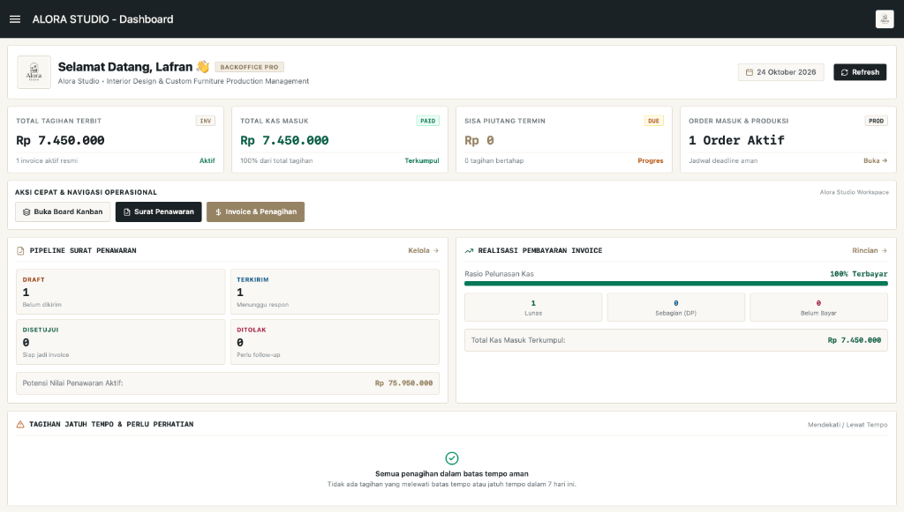
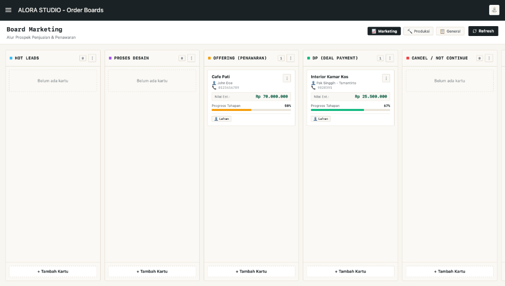
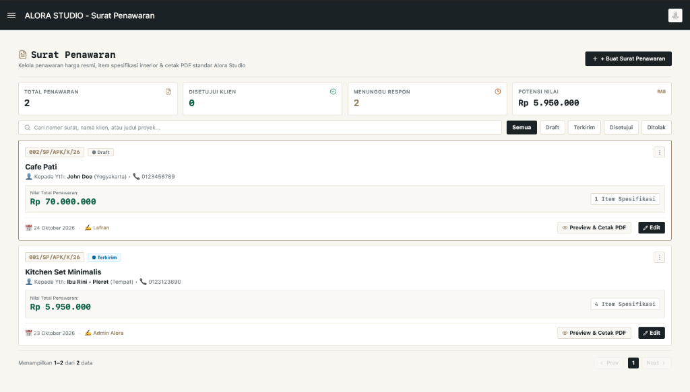
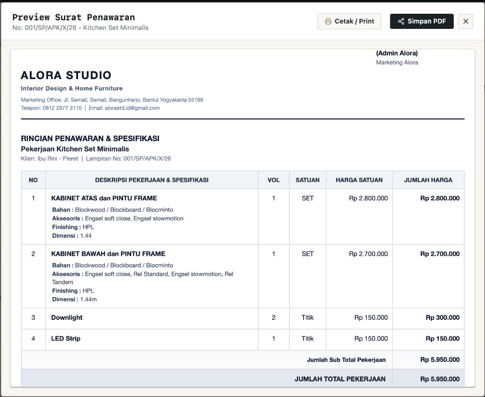
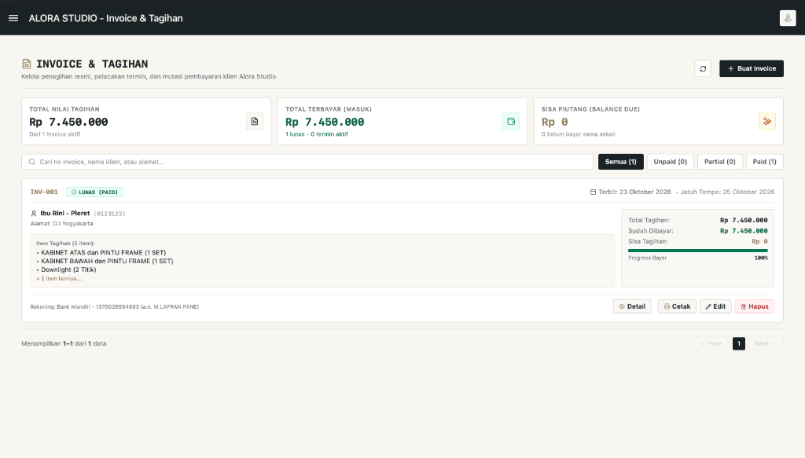
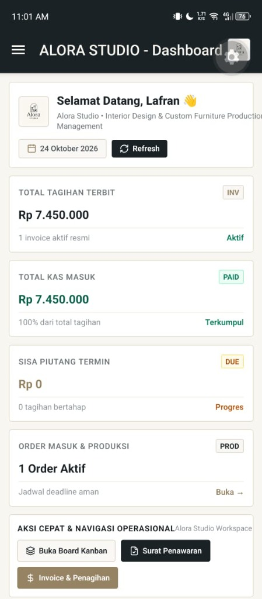
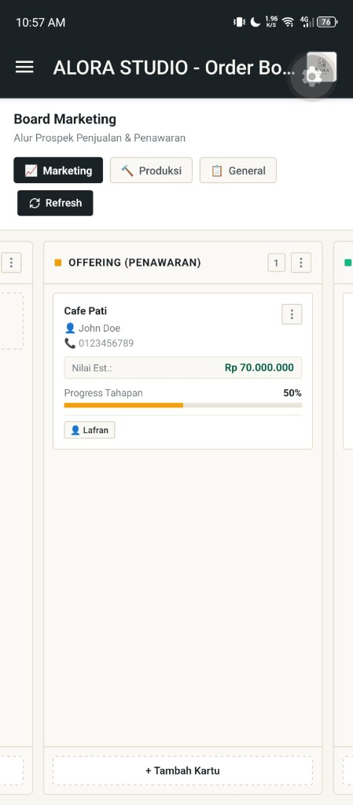
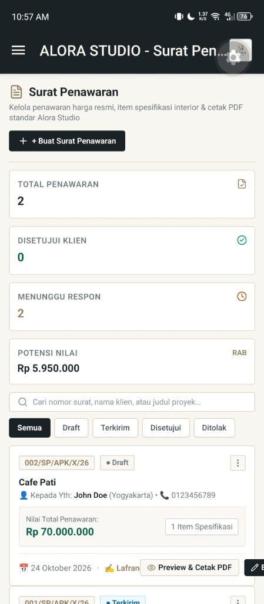
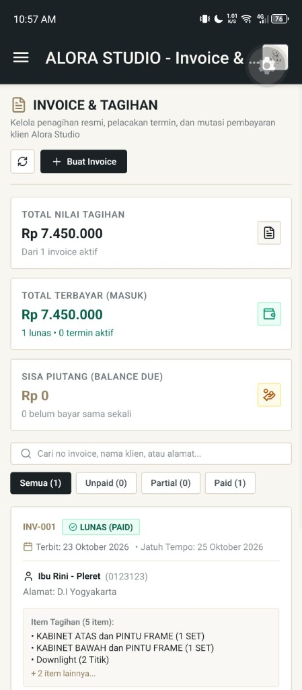

# Alora Studio

> **Open-source operational management & mini-ERP for interior design studios, architects, and custom furniture workshops — with full offline mode support.**

[](LICENSE)
[](#-offline-mode-support)
[](https://reactnative.dev/)
[](https://expo.dev/)
[](https://www.typescriptlang.org/)
[](https://supabase.com/)
[](https://www.nativewind.dev/)

---

## 📌 Overview

**Alora Studio** is an open-source, universal backoffice application built to manage the end-to-end workflow of interior designers and workshop fabricators — from client leads and formal quotations to production tracking and milestone billing.

Runs seamlessly on **Web Desktop**, **Tablets**, and **Mobile (iOS & Android)** with complete **Offline-First** capability for remote job sites and workshop floors.

---

## 🖥️ Web App Preview

<p align="center">
  
</p>

| Multi-Board Kanban | Quotations & RAB Pipeline |
| :---: | :---: |
| [](assets/screenshots/02-kanban-board.png) | [](assets/screenshots/03-quotations.png) |
| *Track leads and auto-transfer DP orders to production* | *Itemized room specifications & status tracking* |

| Official Quotation PDF Preview | Milestone Invoicing & Payments |
| :---: | :---: |
| [](assets/screenshots/04-quotation-preview.png) | [](assets/screenshots/05-invoices.png) |
| *Print-ready PDF layout with specification tables* | *Progressive term billing (DP to Final Settlement)* |

---

## 📱 Mobile App Preview

| Executive Dashboard | Multi-Board Kanban | Quotations & RAB | Milestone Invoicing |
| :---: | :---: | :---: | :---: |
| [](assets/screenshots/mobile-01-dashboard.png) | [](assets/screenshots/mobile-02-kanban.png) | [](assets/screenshots/mobile-03-quotations.png) | [](assets/screenshots/mobile-04-invoices.png) |
| *Real-time studio KPIs* | *Operational card board* | *Drafting & proposal list* | *Payment & invoice tracking* |

---

## 📶 Offline Mode Support

Built specifically for on-site measurements and workshop environments with spotty or zero internet connectivity:
- **Instant 0ms Loading**: Dashboards, boards, quotations, and invoices load immediately from persistent local cache (*AsyncStorage*).
- **Offline Actions & Outbox Queue**: Create, edit, and move cards or update data freely while offline; changes are saved locally to an outbox queue.
- **Silent Background Auto-Sync**: Queued mutations automatically synchronize with Supabase in the background as soon as connectivity is restored — no page reload required.
- **Real-Time Offline Status**: Clear visual banner alerts the user when offline and displays pending sync counts.

---

## ✨ Features

- **Executive Dashboard**: Real-time financial KPIs (Billed, Paid, Balance Due), sales pipeline value, and urgent production deadline tracking ($\le$ 10 days).
- **Multi-Board Kanban**:
  - *Marketing Board*: Track prospective client leads to deal closure.
  - *Automated Workflow*: Moving a card to **DP** automatically copies it to the **Production Board** with deadlines calculated from the quotation.
  - *Production Board*: Monitor shop-floor and on-site phases with deadline urgency tags.
  - *General Board*: Studio operations and internal tasks.
- **Smart Attachments**:
  - Auto-compressed images (**< 600 KB**) for site photos and 3D renders.
  - PDF document support (up to **10 MB**) for blueprints and contracts with instant preview.
- **Quotation & RAB Engine**: Room-by-room itemized specifications, automated tax/discount calculations, Indonesian Rupiah formatting, and print-ready PDF export.
- **Milestone Invoicing**: Progressive term billing (DP, Milestone 1, Milestone 2, Final Settlement) with payment receipts and status tracking.

---

## 🛠️ Tech Stack

| Layer | Technologies |
| :--- | :--- |
| **Frontend** | React Native 0.86, React 19, Expo SDK 57, Expo Router (File-based Routing) |
| **Styling** | NativeWind v4 (Tailwind CSS), Lucide Icons |
| **State & Cache** | Redux Toolkit, AsyncStorage, SWR Pattern |
| **Backend** | Supabase (PostgreSQL, Storage, Auth, Row Level Security) |
| **Media & Native** | `expo-image-manipulator`, `expo-document-picker`, `expo-print`, `expo-sharing` |
| **Connectivity** | `@react-native-community/netinfo`, Custom Outbox Queue Sync |
| **Language** | TypeScript (Strict Mode) |

---

## 🚀 Quick Start

### 1. Prerequisites
- Node.js `v20+`
- npm or yarn

### 2. Installation
```bash
# Clone repository
git clone https://github.com/spoonart1/order-management.git
cd order-management/AloraStudio

# Install dependencies
npm install
```

### 3. Environment Setup
Create a `.env` file in the root folder:
```env
EXPO_PUBLIC_SUPABASE_URL=https://your-project.supabase.co
EXPO_PUBLIC_SUPABASE_PUBLISHABLE_KEY=your-anon-key
```

### 4. Run Application
```bash
# Start Expo Metro Bundler
npx expo start

# Run on Web Browser
npx expo start --web

# Run on Android / iOS
npx expo start --android
npx expo start --ios
```

---

## 📄 License

This project is licensed under the [MIT License](LICENSE).
